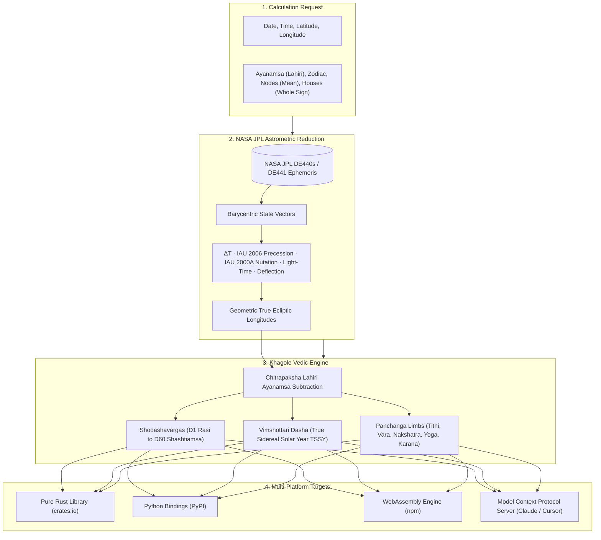

<div align="center">

# 🌌 Khagole (खगोल)
### High-Precision Vedic Jyotish & Astrometric Calculation Engine on NASA JPL Ephemerides

[](https://crates.io/crates/khagole-engine)
[](https://docs.rs/khagole-engine)
[](https://pypi.org/project/khagole-engine/)
[](https://www.npmjs.com/package/khagole-engine)
[](https://github.com/PriyankGahtori/Khagole/stargazers)
[](https://github.com/PriyankGahtori/Khagole/blob/main/LICENSE-MIT)
[](https://priyankgahtori.github.io/Khagole/)
[](https://github.com/PriyankGahtori/Khagole/actions/workflows/ci.yml)

**[🚀 Live Web App & Interactive Demo](https://priyankgahtori.github.io/Khagole/)** · **[📖 API Documentation](https://docs.rs/khagole-engine)** · **[Technical Guides](https://github.com/PriyankGahtori/Khagole/tree/main/docs)** · **[Report Issue](https://github.com/PriyankGahtori/Khagole/issues)**

</div>

---

**Khagole** (खगोल — *The Celestial Sphere* in Sanskrit) is the first modern, memory-safe astrometry and Vedic Jyotish computation engine built directly on NASA JPL DE440s / DE441 development ephemerides in pure Rust.

The same calculation core runs natively on servers (Python bindings), in desktop/mobile apps, and in web browsers via WebAssembly (WASM), guaranteeing bit-for-bit identical results down to the sub-arcsecond across every platform.

---

## ⚡ Why Khagole?

| Capability | **Khagole (खगोल)** | Swiss Ephemeris (`swisseph`) | Flatlib / PyEphem |
|---|---|---|---|
| **Core Architecture** | **100% Pure Rust** (Memory-safe, Zero-panic) | Legacy C (Unsafe pointers) | C wrappers / Old Python |
| **Ephemeris Precision** | **NASA JPL DE440s / DE441** (Sub-arcsecond) | Semi-analytic / Moshier fallback | Low-order approximations |
| **Vedic Kundli & Vargas** | **Native D1 through D60 Shodashavarga** | Requires custom division code | Not supported |
| **Vimshottari Dasha** | **True Sidereal Solar Year (TSSY) Solver** | Not supported | Not supported |
| **Panchanga Limbs** | **Sub-millisecond (Tithi, Vara, Nakshatra, Yoga, Karana)** | Custom manual math required | Not supported |
| **In-Browser Execution** | **WebAssembly (<1MB, 100% Offline & Private)** | Heavy Emscripten build (>5MB) | Server-only |
| **Cross-Platform Parity**| **Bit-for-bit identical results** everywhere | Slight compiler/float drift | Inconsistent |
| **AI / Agentic LLM** | **Native Model Context Protocol (`khagole-mcp`)** | None | None |

---

## Key Capabilities

### 🪔 Vedic Astrology (Jyotish Kundali)
- **Divisional Charts (Vargas)**: Computes D1 (Rasi), D9 (Navamsha), and all 16 Shodashavargas (D2 Hora, D3 Drekkana, D4 Chaturthamsa, D7 Saptamsa, D10 Dasamsa, D12 Dwadasamsa, D16 Shodasamsa, D20 Vimsamsa, D24 Chaturvimsamsa, D27 Saptavimsamsa, D30 Trimsamsa, D40 Khavedamsa, D45 Akshavedamsa, D60 Shashtiamsa).
- **Interactive SVG Charts**: North Indian (diamond) and South Indian (box) chart renderers with Google Material 3 typography, arcminute precision (`12°17′`), Kendra elevations, golden Lagna badges, and non-overlapping multi-planet conjunction grids.
- **Vimshottari Dasha Engine**: Multi-level Mahadasha, Antardasha, and Pratyantardasha timeline and hierarchical tree. Computations support **True Sidereal Solar Year (TSSY)** solar return solver matching canonical Parashari standards, alongside 365.2564-day sidereal, 360-day savana, and 365.2422-day tropical standards.
- **Canonical Parashari Defaults**: Out-of-the-box configuration matches canonical Vedic defaults:
  - **Zodiac**: Sidereal
  - **Ayanamsa**: Chitrapaksha Lahiri (`UserSelectedAyanamsa=17`)
  - **Lunar Nodes**: Mean nodes (`TrueNodes=0`)
  - **Position Mode**: True / Geometric (`TruePositions=1`)
  - **House System**: Whole Sign / Rashi Bhava (`W`)
  - **Dasha Year Standard**: TSSY (True Sidereal Solar Year)
- **Panchanga (Five Limbs of Time)**: Sub-millisecond calculation of Tithi, Vara, Nakshatra with Pada, Yoga, and Karana.
- **Global City Geocoding & Auto-Timezone**: Integrated Open-Meteo & Nominatim autocomplete search for any city globally, auto-filling coordinates and resolving exact historical/DST UTC offsets offline via browser `Intl.DateTimeFormat`.

### 🌐 Western Astrology
- **Planets & Points**: Sun through Pluto, lunar nodes, Chiron, and Black Moon Lilith with speed and retrograde status, Ascendant, Midheaven, and Vertex.
- **House Systems**: Eleven systems checked against Swiss Ephemeris (Placidus, Koch, Regiomontanus, Campanus, Topocentric, Alcabitius, Morinus, Porphyry, Equal, Vehlow, Whole Sign).
- **Aspects & Orbs**: Conjunction, sextile, square, trine, opposition, semi-sextile, and quincunx with configurable orbs and moiety methods.
- **Horary & Electional**: Planetary day and hour from computed sunrise/sunset, significators, void-of-course Moon, considerations before judgment, and optimal window searching.
- **Derived & Transits**: Secondary progressions, solar arcs, synastry cross-aspects, and turned charts.

### 🎋 Chinese Astrology
- **Solar Terms & Calendars**: Solar terms (Jie Qi), lunar and leap months, Chinese New Year anchors.
- **BaZi (Four Pillars of Destiny)**: Year, Month, Day, and Hour pillars calculated on true solar time, with Ten Gods, hidden stems, and Luck Pillars.
- **Zi Wei Dou Shu (Purple Star Astrology)**: 12-palace grid, 14 major stars, minor stars, four mutagens (Si Hua), and decennial/annual horoscopes validated against `iztro`.

---

## Installation

Add **Khagole** to your project across Rust, Python, or JavaScript/TypeScript:

```bash
# Rust (Cargo)
cargo add khagole-engine

# Python (pip, CPython ≥ 3.12)
pip install khagole-engine

# JavaScript / Node.js / Browser (npm)
npm install khagole-engine
```

### 🌐 Web Browser via CDN (Zero Build Tools)

Import directly in any web page with a single `<script type="module">` tag, with zero bundlers or dependencies:

```html
<script type="module">
  import init, { Engine, calcPanchang, calcDivisional, calcVimshottariDasha, nakshatraInfo } 
    from 'https://cdn.jsdelivr.net/npm/khagole-engine@0.0.12/khagole_engine_wasm.js';

  // Initialize WebAssembly runtime directly from jsDelivr CDN
  await init();

  // 1. Calculate Nakshatra & Pada
  const moonNak = nakshatraInfo(217.9496);
  console.log(`Moon in ${moonNak.name} Pada ${moonNak.pada} (Lord: ${moonNak.lord})`);

  // 2. Calculate Vedic Panchanga
  const panchang = calcPanchang(150.5392, 217.9496, 2433541.6694);
  console.log(`Tithi: ${panchang.tithi.name}, Vara: ${panchang.vara.name}`);
</script>
```

### 🤖 Model Context Protocol (MCP) Server for AI & LLMs

Khagole includes a high-speed MCP server for **Claude Desktop**, **Cursor**, **Gemini**, and **Copilot**:

```json
{
  "mcpServers": {
    "khagole": {
      "command": "cargo",
      "args": ["run", "--release", "-p", "khagole-mcp"]
    }
  }
}
```

---

## 🌟 Complete Examples & Celebrity Horoscopes

Working, tested examples outputting full Vedic horoscopes (Navagrahas, Lagna, Nakshatras & Padas, Panchanga, D9 Navamsha, and Vimshottari Dasha) for **Steve Jobs** and **Albert Einstein**:

| Example | Platform | How to Run | Link |
|---|---|---|---|
| **Web Browser (CDN)** | Vanilla JS / HTML | Open `examples/web-cdn/index.html` in browser | [**`examples/web-cdn`**](examples/web-cdn) |
| **Python** | Python ≥ 3.12 (`khagole-engine`) | `python examples/python/celebrity_chart.py` | [**`examples/python`**](examples/python) |
| **Node.js** | Node.js ESM (`khagole-engine`) | `node examples/nodejs/celebrity_chart.mjs` | [**`examples/nodejs`**](examples/nodejs) |
| **Rust** | Rust / Cargo | `cargo run --manifest-path examples/rust/Cargo.toml` | [**`examples/rust`**](examples/rust) |
| **REST API** | FastAPI / HTTP Microservice | `uvicorn examples.rest-api.app:app --port 8000` | [**`examples/rest-api`**](examples/rest-api) |

---

## Rust Usage

```rust
use khagole_engine::ephemeris::{Kernel, KernelSet, Spk};
use khagole_engine::{calculate_chart, ChartRequest, UtcInstant};

let mut kernels = KernelSet::new();
kernels.push(Kernel::new("de440s.bsp", Spk::open("kernels/de440s.bsp")?)?);

let request = ChartRequest::new(UtcInstant::parse("1987-05-17T14:30:00Z")?, 41.9, 12.5);
let chart = calculate_chart(&kernels, &request)?;
println!("{}", serde_json::to_string_pretty(&chart)?);
```

### Vedic Chart Calculation (WASM / Node.js / Browser)

```javascript
import init, { Engine, calcDivisional, calcPanchang, calcVimshottariDasha, julianDay } from "khagole-engine";

await init();
const engine = new Engine();
engine.addKernel("de440s-1950-2050.bsp", kernelBytes);

// Calculate Sidereal Vedic Chart with canonical Parashari defaults
const chart = engine.chart({
  utc: "1950-09-17T04:04:00Z",
  latitude: 23.784,
  longitude: 72.636,
  zodiac_type: "sidereal",
  ayanamsa: "lahiri",
  position_mode: "true",
  node_type: "mean",
  house_system: "W",
});

const ascLon = chart.planets.find(p => p.name === "Ascendant").ecliptic_longitude;
const moonLon = chart.planets.find(p => p.name === "Moon").ecliptic_longitude;
const jd = julianDay("1950-09-17T04:04:00Z");

const d1 = calcDivisional(chart, ascLon, "D1");
const d9 = calcDivisional(chart, ascLon, "D9");
const dasha = calcVimshottariDasha(moonLon, jd, 3, "tssy");
```

---

## Language Bindings & Packages

- **Rust**: [`khagole-engine`](https://crates.io/crates/khagole-engine) and [`khagole-mcp`](https://crates.io/crates/khagole-mcp) on [crates.io](https://crates.io/crates/khagole-engine).
- **Python** ([`khagole-engine` on PyPI](https://pypi.org/project/khagole-engine/), CPython ≥ 3.12): Fast PyO3 bindings with native precompiled wheels for Linux (x86_64, aarch64, musl), macOS (universal2), and Windows (x64). See [crates/khagole-engine-py](https://github.com/PriyankGahtori/Khagole/tree/main/crates/khagole-engine-py).
- **JavaScript / WebAssembly** ([`khagole-engine` on npm](https://www.npmjs.com/package/khagole-engine)): In-browser and Node.js execution with zero network latency. See [crates/khagole-engine-wasm](https://github.com/PriyankGahtori/Khagole/tree/main/crates/khagole-engine-wasm).
- **CDN**: Available globally via jsDelivr: `https://cdn.jsdelivr.net/npm/khagole-engine@0.0.12/khagole_engine_wasm.js`.

---

## Documentation

- [API Reference on docs.rs](https://docs.rs/khagole-engine)
- [API Guide](https://github.com/PriyankGahtori/Khagole/blob/main/docs/api.md): Request parameters, options, chart JSON schema, and error codes
- [Ephemerides Guide](https://github.com/PriyankGahtori/Khagole/blob/main/docs/ephemerides.md): SPK kernels, date spans, in-memory excerpts
- [Accuracy Verification](https://github.com/PriyankGahtori/Khagole/blob/main/docs/accuracy.md): Stage-by-stage verification against JPL, Skyfield, and Swiss Ephemeris
- [Architecture](https://github.com/PriyankGahtori/Khagole/blob/main/docs/architecture.md): Core engine and pipeline layout

---

## 🏛️ System Architecture



---

## Repository Layout

| Path | Description |
|---|---|
| `crates/khagole-engine` | Core Rust calculation library |
| `crates/khagole-engine-py` | Python bindings (PyO3 & maturin) |
| `crates/khagole-engine-wasm` | WebAssembly bindings (wasm-bindgen & wasm-pack) |
| `crates/khagole-mcp` | Model Context Protocol (MCP) server |
| `site/` | Modern client-side web application deployed to GitHub Pages |
| `tests/fixtures/*.json` | Acceptance test golden charts |
| `tests/data/de440s_2000.bsp` | One-year DE440s excerpt for automated test suites |
| `scripts/fetch-kernels.sh` | Downloads full JPL DE440s / DE441 kernels |
| `scripts/build-site.sh` | Compiles WASM, extracts DE440s excerpt, and builds `target/site` |

---

## Testing & Verification

```bash
# Run test suite using the committed excerpt
cargo test --workspace --exclude khagole-engine-py

# Download full DE440s (1849–2150) to run full-range ephemeris verification tests
scripts/fetch-kernels.sh

# Lint codebase
cargo clippy --workspace --all-targets -- -D warnings
```

---

## ⭐ Star History & Community

If you find **Khagole** useful for your projects, astrological software, or AI agents, please consider starring the repository! It helps more developers discover the engine.

[](https://star-history.com/#PriyankGahtori/Khagole&Date)

---

## 🤝 Contributing

Contributions, issues, and feature requests are welcome!
- Check out the [Contributing Guide](https://github.com/PriyankGahtori/Khagole/blob/main/CONTRIBUTING.md) to get started.
- Open an [Issue](https://github.com/PriyankGahtori/Khagole/issues) for bug reports, divisional chart expansions, or feature suggestions.

---

## Credits & Reference Works

**Khagole** is built on top of and inspired by exceptional foundational works across astronomy, astrometry, and astrology:

- **[astroceleste-engine](https://github.com/ffalcinelli/astroceleste-engine)** by Francesco Falcinelli: The upstream Rust astrometric calculation engine, SPK/DAF NASA JPL kernel parser, astronomical reduction pipeline architecture, and golden chart testing framework.
- **[Skyfield](https://github.com/skyfielders/python-skyfield)** by Brandon Rhodes (MIT License): Precision astronomical reduction routines ported from Python to pure Rust, including ΔT models, IAU 2000A nutation tables, IAU 2006 precession, aberration, light-time correction, and gravitational deflection.
- **NASA Jet Propulsion Laboratory (JPL)**: Planetary and lunar development ephemerides (DE440s / DE441), the primary gold-standard foundation for celestial positions.
- **[Swiss Ephemeris](https://www.astro.com/swisseph/)** by Astrodienst (Alois Treindl & Dieter Koch): Benchmark reference for planetary position verification, ayanamsa values, and house cusp systems.
- **[Jagannatha Hora](https://www.vedicastrologer.org/jh/)** by P.V.R. Narasimha Rao: Standard reference benchmark for canonical Vedic Jyotish calculations, Shodashavarga divisional chart algorithms, and True Sidereal Solar Year (TSSY) Vimshottari Dasha calculations.
- **[iztro](https://github.com/SylarLong/iztro)** by Sylar Long (MIT License): Reference implementation and star brightness tables for Chinese Zi Wei Dou Shu astrology.
- **[Open-Meteo](https://open-meteo.com/) & [OpenStreetMap Nominatim](https://nominatim.openstreetmap.org/)**: Global city geocoding, coordinates, and timezone resolution datasets.

---

## License

Dual-licensed under either:
- Apache License, Version 2.0 ([LICENSE-APACHE](https://github.com/PriyankGahtori/Khagole/blob/main/LICENSE-APACHE))
- MIT License ([LICENSE-MIT](https://github.com/PriyankGahtori/Khagole/blob/main/LICENSE-MIT))

See [NOTICE](https://github.com/PriyankGahtori/Khagole/blob/main/NOTICE) for full third-party copyright notices and attribution statements.
